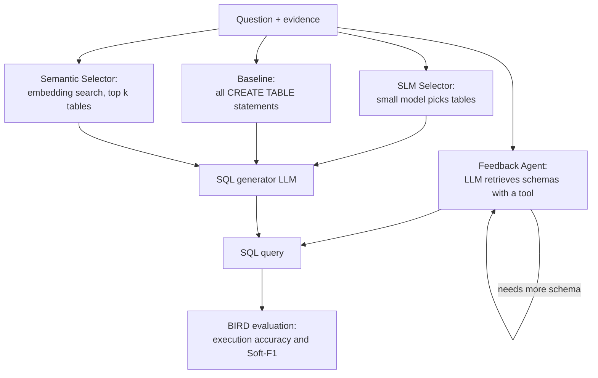

# Pipeline Optimization of Agentic LLMs for Text-to-SQL

Code and run logs for my M.S. thesis at San José State University (May 2026). The thesis asks
how to lower the cost of text-to-SQL by sending an LLM fewer tokens and using smaller models.

**Read the thesis:** [SJSU ScholarWorks](https://scholarworks.sjsu.edu/etd_theses/5796/)
([DOI](https://doi.org/10.31979/etd.d78f-5ux6))

## Main result

Most of the cost comes from schema linking, which means working out which tables a question
needs. Replacing that LLM step with embedding search made the pipeline cheaper and faster, and
it also scored higher.

With Qwen3-14B, retrieving the top 8 of 75 tables did the following:

| Metric | Baseline (all tables) | Semantic Selector (k=8) |
|---|---|---|
| Execution accuracy | 30.00% | about 36.6% |
| Soft-F1 | 35.01% | about 43% |
| Average tokens per question | 23,672 | about 2,600 (about 9× fewer) |
| Average latency | 6.7 s | about 2.1 s (about 3× faster) |

Baseline values come from the thesis tables. Semantic Selector values are read off the plots in
thesis Figures 5–7, which have no data labels, so they are approximate.

The other two ideas lost accuracy. A small model acting as table selector and a tool-calling
feedback agent both cost fewer tokens, but neither matched the baseline.

## The four methods



| Method | How it finds tables | LLM calls per question | Inspired by |
|---|---|---|---|
| Baseline | Sends every `CREATE TABLE` statement | 1 | Naive approach |
| SLM Selector | Qwen3-4B or 8B selects tables, Qwen3-14B writes SQL | 2 | MAC-SQL |
| Semantic Selector | Embeds the question and evidence, then retrieves the top k table descriptions | 1 | CHESS-SQL |
| Feedback Agent | The LLM gets table names and a schema tool, and decides what to fetch | Varies (1.3 tool calls on average) | RAISE |

Semantic Selector uses `all-MiniLM-L6-v2` embeddings and a FAISS inner-product index over
normalized vectors, which gives cosine similarity. Each table description holds the table name,
its category and its column descriptions.

## Results

All methods ran on the 500-question BIRD Mini-Dev set, which covers 11 databases and 75 tables
in MySQL. Execution accuracy is BIRD's strict comparison of query results. Soft-F1 is BIRD's
more lenient version, which reduces the effect of column order and missing values.

### Thesis tables

| Method | Execution % | Soft-F1 % | Avg tokens | Max tokens | Avg latency |
|---|---:|---:|---:|---:|---:|
| Baseline (Qwen3-14B) | 30.00 | 35.01 | 23,672 | 24,713 | 6.7 s |
| SLM Selector: 4B + 14B | 21.00 | 23.37 | 987 + 1,143 | 1,207 + 3,960 | 2.2 s |
| SLM Selector: 8B + 14B | 23.00 | 25.67 | 991 + 1,143 | 1,216 + 3,677 | 3.7 s |
| SLM Selector: 14B + 14B (control) | 23.00 | 26.28 | 984 + 1,103 | 1,198 + 3,897 | 4.4 s |
| Feedback Agent | 25.60 | 29.21 | 1,213 | 2,845 | 4.51 s |

### Semantic Selector by k

These values are read off the plots in thesis Figures 5–8, so they are approximate.

| k | Execution % | Soft-F1 % | Avg tokens | Max tokens | Avg latency | Full recall |
|---:|---:|---:|---:|---:|---:|---:|
| 2 | about 33.4 | about 37 | about 900 | about 2,200 | about 1.8 s | about 40% |
| 8 | about 36.6 | about 43 | about 2,600 | about 6,200 | about 2.1 s | about 85% |
| 25 | about 37.8 | about 43 | about 8,100 | about 12,500 | about 3.0 s | about 93% |

Full recall is how often the search retrieved every table the gold query used. Accuracy
flattens after k=8, while tokens and latency keep rising. Full recall reaches about 90% at k=10
and about 96% at k=30, so accuracy can't improve much beyond that without better retrieval.

### Earlier gpt-oss-20b runs

These are exploratory runs from the logs in this repo, and they aren't in the published thesis.
They use a larger model and report input tokens only. The pattern was similar for
Semantic Selector, which beat the baseline with about 6× fewer input tokens. The latency
numbers aren't comparable with the thesis tables because the setups differ.

| Method | Execution % | Soft-F1 % | Avg input tokens |
|---|---:|---:|---:|
| Baseline | 45.00 | 50.46 | 23,127 |
| Semantic Selector (k=10) | 46.80 | 52.86 | 3,727 |
| Feedback Agent | 38.80 | 44.05 | 1,100 |

## What I learned

- **Don't spend an LLM call on schema linking.** An embedding model can run on a CPU, and it
  can't invent table names. The small selector models often did.
- **Small helper models can backfire on a self-hosted GPU.** Their weights take up memory that
  could have gone to the main model's KV cache.
- **Measure your maximum tokens.** vLLM rejects requests over `--max-model-len`, and setting it
  just above your measured maximum leaves more memory for throughput.
- **An agent with tools won't necessarily explore.** The Feedback Agent averaged only 1.3 tool
  calls, and its prompt probably needs more work.

## Known issues

- **Feedback Agent table list:** [`nodes.py`](text2sql/nodes.py) fills `tables_by_domain` from
  `fix_llm_prompt.txt` instead of `tables_by_domain.txt`. Its system prompt therefore contains
  the wrong text where the domain-grouped table list belongs. The user message still lists the
  table names, but this may have held back the agent.
- **Not turnkey yet:** the scripts have hardcoded paths, and the BIRD data isn't included.
- **Logs and thesis:** the repo stops at April 4, 2026, and doesn't include the final Qwen3-14B
  Semantic Selector runs. Some logged runs also differ from the thesis tables, so treat the
  thesis as the source of record.

## Repository layout

| Path | Contents |
|---|---|
| `text2sql/` | The pipeline: `agents.py` (the four methods), `nodes.py` (graph nodes and LLM calls), `tools.py` (MySQL tools), `retrieval.py` (FAISS semantic search), `prompts/` |
| `scripts/run_bird.py` | Runs a method on BIRD Mini-Dev and records accuracy, tokens and latency |
| `notebooks/` | Builds the table-description embeddings and the distinct-value index |
| `data/embeddings/` | Embedding variants. `retrieval.py` uses `csv_table_descriptions` |
| `mini_dev_main/evaluation/` | BIRD evaluation scripts, adjusted for this setup |
| `mini_dev_main/sql_result/` | Generated SQL, per-question metadata and evaluation logs |
| `DailyDocumentation.ipynb` | Daily research notes, including dead ends |

Earlier versions of the pipeline (V0–V3) are in the history. The code exactly as it was at
thesis submission is at the [`thesis-submission`](../../tree/thesis-submission) tag.

## Running it

You'll need these first:

- Python 3.12 (`agents.py` uses nested f-string quotes)
- A GPU that can serve your chosen model with vLLM. The thesis used an A100 (40 GB), plus an
  H100 (80 GB) for the two-model runs
- MySQL with the [BIRD Mini-Dev](https://github.com/bird-bench/mini_dev) data loaded into one
  database called `bird_mini_dev`
- A read-only MySQL user that matches `text2sql/tools.py`

1. Install the dependencies. The repo doesn't have a lockfile yet.

   ```bash
   pip install vllm langchain langchain-community langchain-openai langgraph \
       sentence-transformers faiss-cpu mysql-connector-python pymysql tqdm numpy
   ```

2. Serve a model on port 8000.

   ```bash
   vllm serve Qwen/Qwen3-14B --host 0.0.0.0 --port 8000 \
       --enable-auto-tool-choice --tool-call-parser hermes --max-model-len 8192
   ```

3. In `scripts/run_bird.py`, set `agent_name`, `llm_path`, `model_name` and the hardcoded
   BIRD data paths. `llm_path` must match the model name vLLM is serving.

   Agent names are `baseline`, `llmsearch` (SLM Selector), `semanticsearch` (Semantic Selector)
   and `llmsearchgen` (Feedback Agent). The k value comes from `get_tables_semantic_search` in
   `text2sql/retrieval.py`.

4. Run the script. Paths inside the repo resolve relative to the source files, so it works from
   any directory.

   ```bash
   python scripts/run_bird.py
   ```

5. Set `eval = True` in `run_bird.py` to score the run with the BIRD evaluation scripts.

## What I would do next

- Add locality-sensitive hashing to find values mentioned in a question, as CHESS-SQL does
- Improve retrieval by adding sample questions to the table descriptions
- Test parallel generation that creates several candidates and picks the best
- Fix the Feedback Agent table list and re-measure it
- Replace the hardcoded settings with configuration, and add tests
- Expose the pipeline as an MCP server

## Citation

Conant, Peter, "Pipeline Optimization of Agentic LLMs for Text-to-SQL" (2026). *Master's Theses*.
5796. https://doi.org/10.31979/etd.d78f-5ux6
